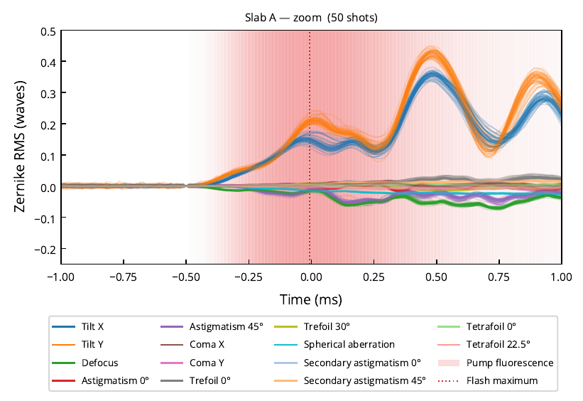
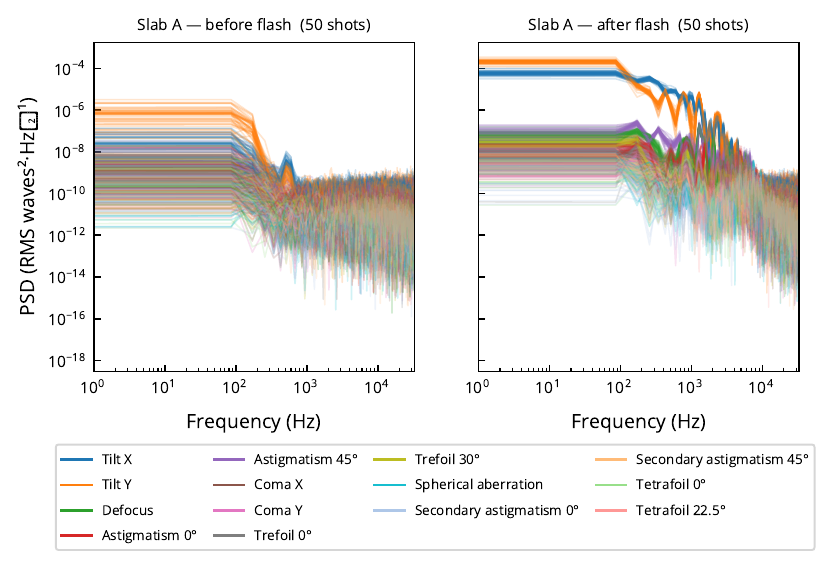
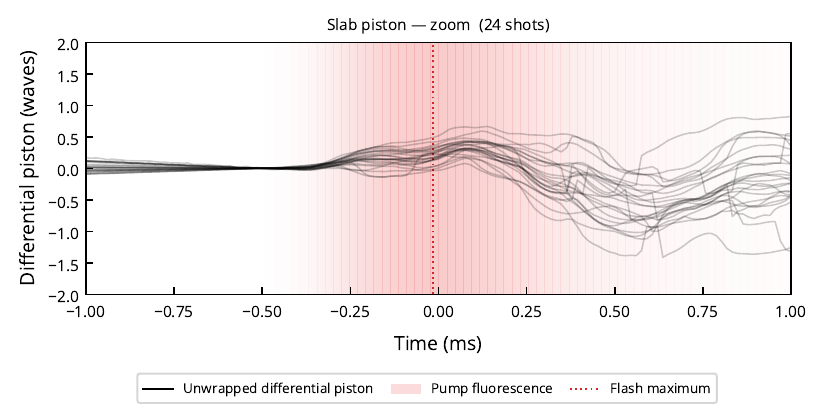
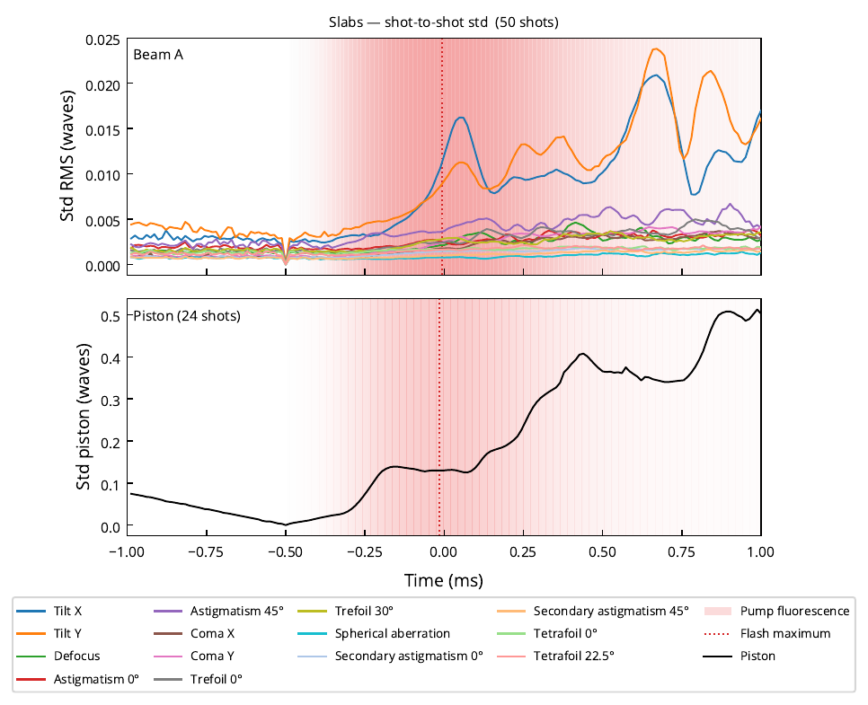

# CHOCOLATE 2 — coherent beam combining analysis

Analysis pipeline for the CHOCOLATE 2 experimental campaign, carried out on the
HERA laser facility at LULI. The experiment characterises the wavefront and
piston stability of two high-energy Nd:glass amplification chains
(2 x 200 J, 90 mm beams) in view of coherent beam combining (CBC).

This repository contains the code that turns raw PHASICS SID4 acquisitions into
the figures of the manuscript. It is written so that the results can be
reproduced, inspected and reused by someone who did not run the experiment.

## What the code does

The processing is a four-stage pipeline:

1. **Acquisition** — a Phantom high-speed camera behind a PHASICS SID4
   four-wave lateral shearing interferometer (kHz-SID4)  records the interferograms of
   both beams around each laser shot.
2. **Wavefront analysis** — the SID4 software projects each frame on the
   Zernike basis up to radial order 4 and exports one XML file per frame.
3. **Partitioning** — Python condenses thousands of XML and TIFF files per
   shot into a handful of `.npy` arrays (a 1.34 GB acquisition becomes about
   130 kB). This is the only stage that needs the raw data.
4. **Interpretation** — cross-shot analysis, CBC efficiency estimation and
   figure production. This stage runs in minutes on a laptop from the
   condensed results alone.

Each measurement is identified by the time it was taken, in the form
`YYYY-MM-DD-HH-MM`, which is the key used everywhere in the code and in
`data_base.json`.

## Installation

Requires Python 3.9 or newer.

```bash
git clone https://github.com/<your-account>/chocolate-cbc-analysis.git
cd chocolate-cbc-analysis
```

### With uv (recommended)

[uv](https://docs.astral.sh/uv/) creates the virtual environment, installs the
package in editable mode and pins every dependency version in `uv.lock`.

Install uv once:

```bash
# Linux / macOS
curl -LsSf https://astral.sh/uv/install.sh | sh
# Windows (PowerShell)
powershell -ExecutionPolicy ByPass -c "irm https://astral.sh/uv/install.ps1 | iex"
```

Then, from the repository root:

```bash
uv sync --extra progress
```

This creates `.venv/`, installs the `chocolate` package in editable mode with
its dependencies, the optional `tqdm` progress bars and the `dev` tools
(`black`, `ruff`). Use `uv sync --no-dev` to skip the dev tools.

Run a script inside the environment without activating it:

```bash
uv run python scripts/01_overview.py
```

or activate it as usual (`source .venv/bin/activate` on Linux / macOS,
`.venv\Scripts\activate` on Windows).

### With venv and pip

```bash
python -m venv .venv
# Linux / macOS
source .venv/bin/activate
# Windows (PowerShell)
.venv\Scripts\Activate.ps1

python -m pip install --upgrade pip
pip install -e ".[progress]"
pip install --group dev   # optional, requires pip >= 25.1
```

The `-e` flag installs the package in editable mode: Python records the
location of the source instead of copying it, so any change to the code takes
effect immediately.

### Configuration

Then create your local configuration:

```bash
cp config/config.example.yaml config/config.yaml
```

and edit the `root` entry so that it points to your data directory, the one
containing `data_base.json` and `RESULTS/` (see [Data](#data) for the full
layout). To try the code without downloading anything, point it to the
demonstration dataset shipped with the repository:

```yaml
root: "data/demo"   # relative paths are resolved from where the script is run
```

Figures use the Open Sans font. If it is not installed, matplotlib falls back
to DejaVu Sans and everything still works.

## Data

The code and the data are distributed separately, and **not every script
needs every piece of data**. The raw acquisitions are far too heavy to be
shared in full, so most users will have the condensed results only, a
truncated copy of the raw data at best, or nothing but the demonstration
dataset. Each script states what it reads; the table in
[Scripts](#scripts) sums it up.

| What | Size | Where | Needed by |
|---|---|---|---|
| Condensed results (`RESULTS/`) and `data_base.json` | about 1 GB | Zenodo, DOI to be added | every interpretation script |
| `test_polynome/` sub-root | about 170 MB | on request | `efficiency_model_comparison.py` only |
| Raw acquisitions (`PHASICS_NEW/`, SID4 exports) | about 1 TB | not distributed, truncated copies on request | `partition.py` only |
| Demonstration dataset | about 16 MB | `data/demo/` in this repository | trying the code |

### Layout of the data directory

```
<root>/
├── data_base.json                 metadata of every measurement
├── RESULTS/                       condensed results, one folder per measurement
│   └── YYYY-MM-DD-HH-MM/
│       ├── YYYY-MM-DD-HH-MM_data__WA.npy    Zernike decomposition, beam A
│       ├── YYYY-MM-DD-HH-MM_tag__WA.npy     column labels
│       ├── YYYY-MM-DD-HH-MM_time__WA.npy    time base of beam A
│       ├── ... same three files for beam B (WB)
│       ├── YYYY-MM-DD-HH-MM_piston.npy      differential piston (wrapped, rad)
│       ├── YYYY-MM-DD-HH-MM_IA.npy          pump fluorescence seen on beam A
│       ├── YYYY-MM-DD-HH-MM_IB.npy          pump fluorescence seen on beam B
│       └── YYYY-MM-DD-HH-MM_time.npy        time base of piston and intensities
├── PHASICS_NEW/                   raw acquisitions, only for partition.py
│   └── YYYY-MM-DD-HH-MM_PHASICS/
│       └── SID4/YYYY-MM-DD-HH-MM_W<A|B>/Results/ACC ImgXXXXXX.xml
└── test_polynome/                 independent sub-root, see below
    ├── data_base.json
    ├── RESULTS/
    └── PHASICS_NEW/
```

Only `data_base.json` and `RESULTS/` are required for the interpretation
stage. `PHASICS_NEW/` is only read when the raw acquisitions are partitioned
again, and can be absent.

`test_polynome/` is a **self-contained sub-root**, with its own
`data_base.json`, `RESULTS/` and `PHASICS_NEW/`, independent of the main
database. It holds a single acquisition (`2025-11-28-17-34_PHA_SAME`), both
beams analysed through masks of the same size, with the full wavefront maps
exported by the SID4. It is used by `efficiency_model_comparison.py` to
compare the efficiency computed from the raw maps with the one computed from
the Zernike polynomials, and by nothing else.

### Demonstration dataset

`data/demo/` is a small but valid data directory: point `root` to it and the
interpretation scripts run as they would on the full dataset. It holds four
measurements from 2025-12-05, all recorded at 66 000 fps over ±4000 frames
around the shot, with both beams, the piston and the pump fluorescence:

| Measurement | Amplifiers fired |
|---|---|
| `2025-12-05-14-23` | 108 mm slabs (A and B) |
| `2025-12-05-14-45` | 108 mm slabs (A and B) |
| `2025-12-05-16-06` | 45 mm rods (A and B) |
| `2025-12-05-16-12` | 45 mm rods (A and B) |

Its `data_base.json` lists these four measurements only. There is no raw
data and no `test_polynome/` sub-root in it.

The demonstration dataset **cannot run everything**. Two shots per
amplifier is enough to exercise the code and see the shape of the figures,
not to reproduce the statistics of the manuscript, and the scripts that
study a given shot, a given series or a given day need measurements that
are not in it.

## Scripts

Every script lives in `scripts/`, runs on its own (`python scripts/<name>.py`)
or cell by cell in an IDE, and writes its figures to `figures/`. The
parameters to edit are gathered at the top of each file.

| Script | What it does | Data needed | Runs on the demo |
|---|---|---|---|
| `01_overview.py` | Quick tour of the slab shots, see [below](#overview) | `RESULTS/` | yes |
| `partition.py` | Partitioning stage: condenses the raw SID4 exports and interferograms into the `.npy` arrays of `RESULTS/` | `PHASICS_NEW/` | no |
| `on_shot_distortion1.py` | Zernike coefficients of each beam and differential piston around the shot, for the rods and the slabs, zoom and full window | `RESULTS/` | yes |
| `spectral_distortion.py` | Power spectral density of the aberrations and of the piston, before and after the flash | `RESULTS/` | yes |
| `std_over_time.py` | Shot-to-shot standard deviation against time, beam A, beam B and piston | `RESULTS/` | yes |
| `precompensated_efficiency.py` | Combining efficiency left once the mean differential is pre-compensated, wavefront and piston separately, and its dependence on the correction delay | `RESULTS/` | yes |
| `day_by_day_dispersion.py` | Separates the within-day dispersion of an aberration from the day-to-day one | `RESULTS/`, at least 5 shots per day | no |
| `post_shot_fluctuations.py` | Relaxation of the wavefront in the minutes following a slab shot, and two long acquisitions | `RESULTS/`, series of 2025-12-01 | no |
| `Correction_pipline.py` | Pre-shot correction synchronised on the dominant vibration period, on shot 2025-12-04-09-28 | `RESULTS/`, that shot and its learning base | no |
| `efficiency_model_comparison.py` | Compares three ways of computing the combining efficiency: raw maps, Zernike reconstruction, analytic approximation | `test_polynome/` | no |

### Overview

`01_overview.py` is the entry point: it gives a first look at the data in
a few seconds and checks that everything is read correctly. It does no
analysis of its own. It reuses portions of `on_shot_distortion1.py`,
`spectral_distortion.py` and `std_over_time.py`, restricted to the shots
where only the 108 mm slabs are fired, beam A, in the ±1 ms zoom window
around the flash. The pump fluorescence is shown as a red background, its
maximum as a dotted line. The figures below were produced from the full
dataset.

Zernike coefficients of beam A, every shot superimposed:



Their power spectral density, before and after the flash:



Unwrapped differential piston between the two beams:



Shot-to-shot standard deviation, aberrations of beam A at the top, piston at
the bottom:



## Repository layout

```
config/          local configuration (config.yaml is not tracked)
src/chocolate/   the library
scripts/         one script per figure family of the manuscript
data/            demonstration dataset and pointer to the full archive
figures/         generated output, not tracked
docs/            conventions, notes and the figures of this README
```

## Conventions

Zernike coefficients can be expressed in three normalisations of the same
basis, and the choice is always stated explicitly:

| Label | Definition | Also known as |
|---|---|---|
| `amp` | bare polynomial, max&#124;Z&#124; = 1 for every mode | SID4 "PtV mode" |
| `rms` | Noll / OSA-ANSI orthonormal basis | standard orthonormal |
| `ptv` | scaled to the true peak-to-valley excursion of the mode | optical specifications |

See `src/chocolate/zernike.py` for the exact conversion factors and the
mode ordering.

## Citing

If this code or the associated dataset is useful to you, please cite it using
the metadata in `CITATION.cff`.

## License

MIT, see `LICENSE`.
